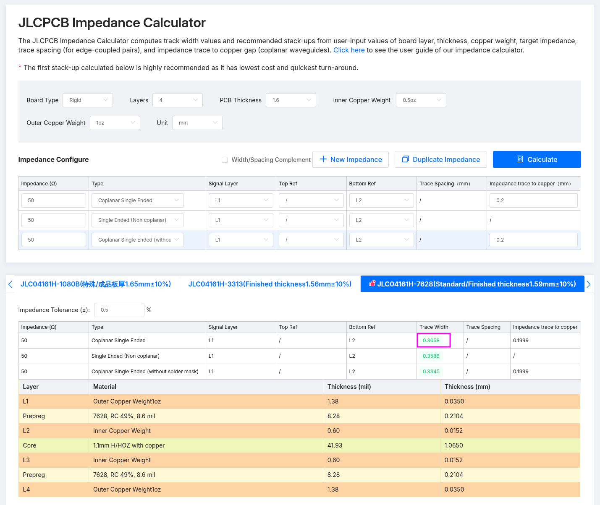

# Electrical Design

## Key Assumptions/Specs

- 50 ohm characteristic impedance
- 70cm-band is the main target frequency (400 MHz to 470 MHz)
- Connected to computer with USB; USB can provide power

## Key Components

- SP8T RF switch
- Low-Noise Amplifier

## Components Selection

### SP8T RF switch

1. Search on Digikey.
2. Category: RF and Wireless → RF Switches.
3. Filter to Active, In Stock.
4. Filter to SP8T and 50 ohms.
5. With these filters applied, there are about 10 options.
6. Main optimization criteria: Select lowest insertion loss.

- **Choice:** SKY13418-485LF
    - Cost: CA$3.88

### RF Low-Noise Amplifier (LNA)

#### Establish Baseline

The following are common LNA chips:

- SPF5189Z
    - Obsolete.
    - Noise Figure @ 900 MHz: 0.60 dB
    - Noise Figure @ 450 MHz (estimated): 0.55 dB
    - Easy to hand solder.
- PGA-103+
    - Sold as a drop-in replacement for SPF5189Z.
    - Noise Figure @ 1 GHz: 0.60 dB
    - Noise Figure @ 400 MHz: 0.5 dB
    - Easy to hand solder.
    - Cost: CA$3.28
- QPL9547
    - Noise Figure @ 1.9 GHz: 0.3 dB
    - Cost: CA$6.91

#### Search

1. Search on Digikey.
2. Category: RF and Wireless → RF Amplifiers.
3. Filter to Active, In Stock.
4. Sort by Noise Figure (main selection criteria).
5. Discard any that target frequencies outside of 70cm UHF.

#### Notable Search Results

- QPL9547
    - Noise Figure @ 1.9 GHz: 0.3 dB
    - Cost: CA$6.91
    - Candidate before searching.
    - Integration Notes:
        - 9 additional passive components required, wow.

- TL0374J
    - Noise figure @ 1.8 GHz: 0.35 dB
    - Cost: CA$2.38
    - Supply Voltage: 5V
    - Frequency Range: 30 MHz to 3 GHz
    - Noise Figure across band: 0.3 – 0.4 dB
    - Integration Notes:
        - Vey similar to QPL9547, but is decently cheaper at a 0.05 dB worse noise figure.
        - Can switch on and off (enable pin).
        - Follow the TL0374J-EVB-C application note (30 MHz to 1 GHz).
            - 11-12 additional components for LNA, wow.
    - Not selected because the application note suggests so many additional components.

#### Choice

**QPL9547**

## Topology and Others

### LNA before or after SP8T?

- Consider: Antennas -> 1x Switch -> 1x LNA
    - Result: Worse noise performance
    - Cost (with LNA=TL0374J): CA$3.88 + CA$2.38 = CA$6

- Consider: Antennas -> 8x LNA -> 1x Switch
    - Result: Better noise performance
        - 8x PGA-103+ before the SP8T switch is better than 1x better LNA after the switch.
    - Cost (with LNA=TL0374J): 8×2.38 + 3.88 = CA$23
    - Cost (with LNA=PGA-103+): 8×3.28 + 3.88 = CA$30

- Decision: 8x PGA-103+ LNA, placed before the SP8T switch.

### 8x LNAs, but only power one at a time

- Use the TPS22917 to switch on/off single devices at a time.

- With C_T open, the come-up time is 100us.

### LNA Passives

- Mainly follow this guide: http://www.g4ddk.com/PGA103amp.pdf
- Validate components selection with this guide: https://nuclearrambo.com/wordpress/designing-and-testing-a-low-noise-amplifier-part-1/
- Component part numbers: https://www.tau.ac.il/~stoledo/Bib/Pubs/Toledo-QEX-Jan-2015.pdf

### Noise Avoidance

- Clip-on ferrites at both ends of the USB cable.
- Use an RF shield/can over the RP2040-Zero to reduce noise.
- Place a via fence across the board between the module area and the RF section, stitching L1, L2 and L4.
- Filter each enable line as it leaves the module area: a series resistor of about 1 kΩ, which also slows the edges, plus 100 pF to 1 nF to ground. Repeat the filter at the switch device.
- Filter power at the module’s input. Use a ferrite plus bulk and 100 pF capacitors, probably.

## PCB Stackup

Ordering from JLCPCB, use recommended "JLC04161H-7628" stackup (note: no "A" suffix).

With the KiCad default clearance of 0.2mm, outside-layer RF traces (Coplanar Single Ended) should be 0.3058mm wide.

### Layout Concept

- GND pour on L1, L2, L4. Power pour(s) (3V3) on L3.
- Route enable signals on L3.

## Component Selection

- Bleed resistor (1M): Mostly anything is fine. Consider >50-100V for support with brief ESD transients.
- On RF capacitors:
    1. Use C0G/NP0 dielectric, never X7R or X5R. This matters most, especially on the input cap.
    2. Murata is a good manufacturer.
    3. 50V to 100V rating is ideal.
