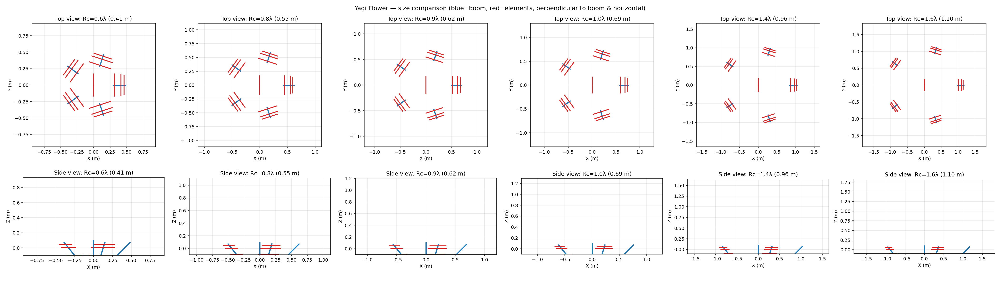
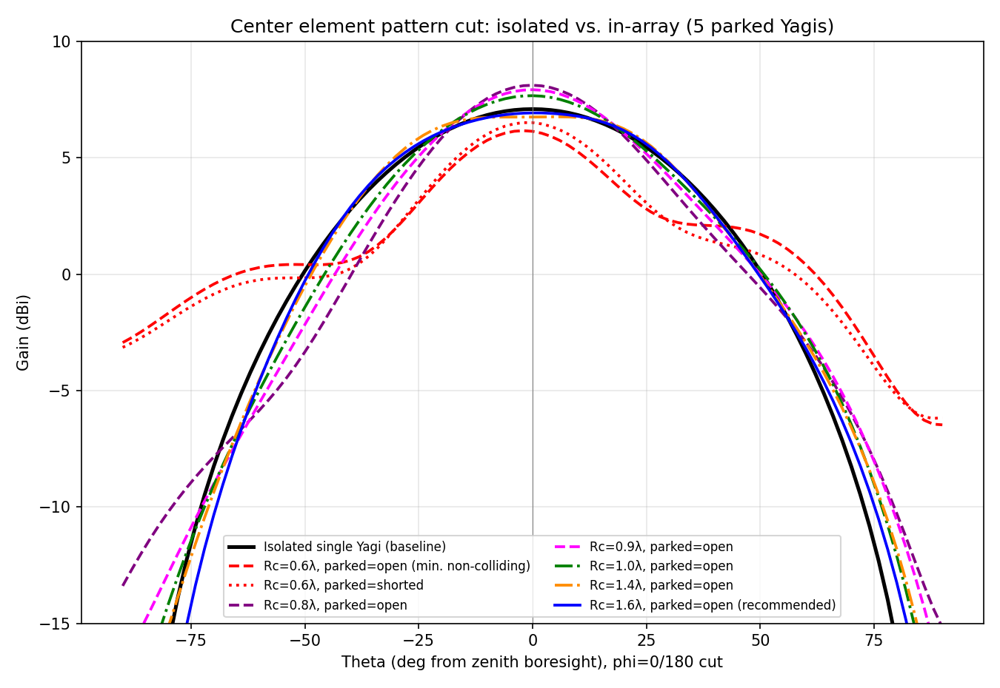

# Yagi Flower - Physical Structure

## Design Considerations

- The yagi feedpoints must be spaced decently far apart.
    - Claude-generated simulations suggest the yagi driven elements should be on a circle with a radius of approximately 1 wavelength (though as little as 0.8 wavelengths may be acceptable).
    - If the antennas are any closer together than that, their directionality flattens out as they tend more toward isotropic radiators.

